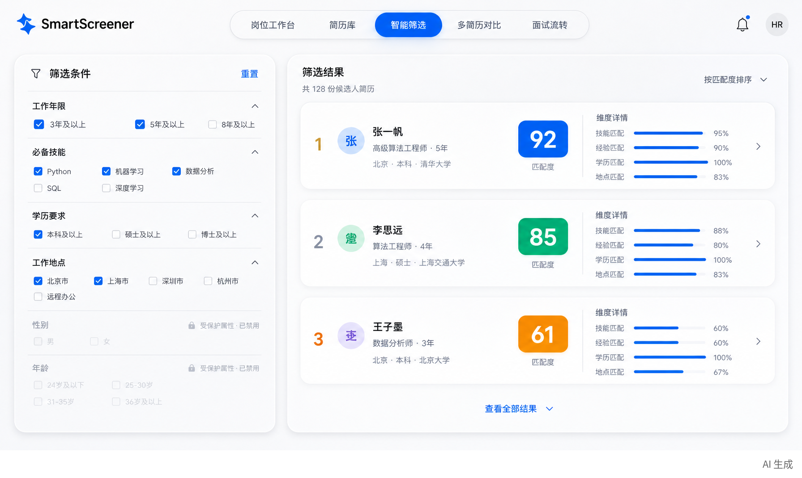

# 澄聘 / 智能招聘决策工作台

以岗位相关证据辅助招聘人员完成 **岗位定义 → 简历入库 → 筛选与对比 → 一面、二面、终面反馈**。界面支持中文；本 README 同时提供英文摘要。当前版本是可运行原型，**尚不适合存放真实企业候选人数据或直接投入大型企业生产环境**。

## Quick start / 快速启动

1. 复制 `backend/.env.example` 为 `backend/.env`，配置可访问的 Ollama 或 OpenAI 兼容模型。不要提交密钥。
2. 执行 `docker compose up --build`。
3. 浏览器打开 `http://localhost:3000`；接口文档在 `http://localhost:8000/docs`。
4. 创建岗位，上传简历，再运行岗位相关评估。界面不使用伪造候选人或虚构分数。

若在 Docker 中使用宿主机 Ollama，请将 `OLLAMA_BASE_URL` 配为容器可访问地址，并确保模型已下载。前端浏览器默认访问本机 8000 端口；远程部署需在构建时设置 `NEXT_PUBLIC_API_URL` 为外部可访问的 HTTPS API 地址，且后端需要配置对应 CORS。当前 Compose 仅适合本机演示。

## 已实现 / Implemented

| 环节 | 当前能力 |
|---|---|
| 岗位 | 模型生成结构化岗位草案与可选评价条件 |
| 简历 | PDF / DOCX / TXT 上传、解析、入库、按岗位查看；单文件上限 10 MB |
| 筛选 | 勾选岗位相关维度、评分与证据展示、受保护属性拦截 |
| 比较 | 最多四位候选人并排查看经验、技能和本次评估分数 |
| 面试 | 一面、二面、终面反馈、岗位能力评分和状态更新 |
| 运行 | FastAPI + SQLAlchemy + Next.js；Docker Compose 本机演示 |

AI 输出可能不准确。缺少原文证据时，界面明确提示人工复核。性别、年龄、婚育等个人属性不作为自动排序依据。

## 企业级差距 / Enterprise readiness

具体的招聘流程、优先级和验收标准见 [企业级交付路线](docs/ENTERPRISE_ROADMAP.md)。

在真实候选人数据进入系统之前，必须补齐：SSO 与角色权限、岗位/候选人级访问控制、审计日志完整性、数据加密与密钥管理、保留期限与删除流程、候选人告知与授权、可配置地区合规策略、模型数据处理协议、恶意文件扫描、迁移和备份恢复、异步批量处理、评分版本与可重复性验证、偏差与误判监测、人工申诉和复核流程。当前后端接口**没有身份认证**，因此不要把 8000 端口暴露到公网。

## 设计参考 / Research

- [Greenhouse structured interviewing](https://www.greenhouse.com/interviewing-at-greenhouse)：统一评分卡、必填事实记录，借鉴为分轮面试反馈。
- [OpenRecruitOS](https://github.com/attitudetalentbridgellp-OpenRecruitOS/OpenRecruitOS)：完整 ATS 流程和自动种子演示数据，借鉴其清晰的本机启动说明。
- [Vekt](https://github.com/Behnoudmst/vekt)：自托管及身份信息脱敏思路，借鉴为模型评分前移除姓名、联系方式等字段。

这些是相关产品与开源项目的参考，并不声称它们是本周 GitHub 排名最高的项目。后续应提供真实录屏、英文界面、测试数据集和一键演示环境；当前仓库的截图仅作界面预览。

## English summary

Chengpin (澄聘) is a self-hostable recruiting workflow prototype. It generates a job draft, stores parsed resumes, shows evidence-based AI suggestions, compares candidates, and records structured interview feedback. Human review is required. The current release lacks authentication and production data controls; use synthetic data only.

MIT License.
